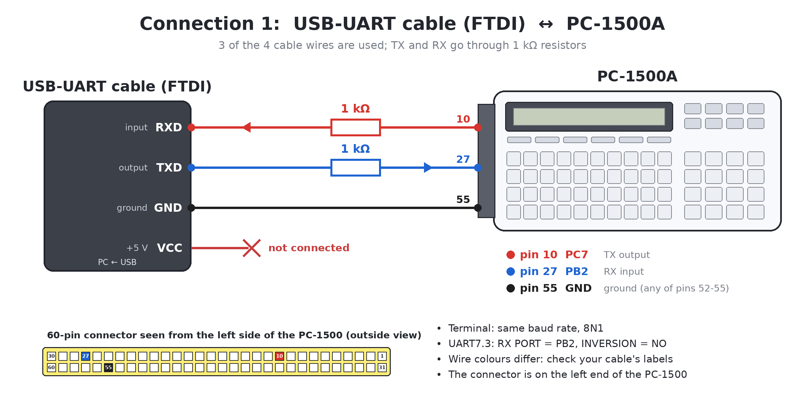
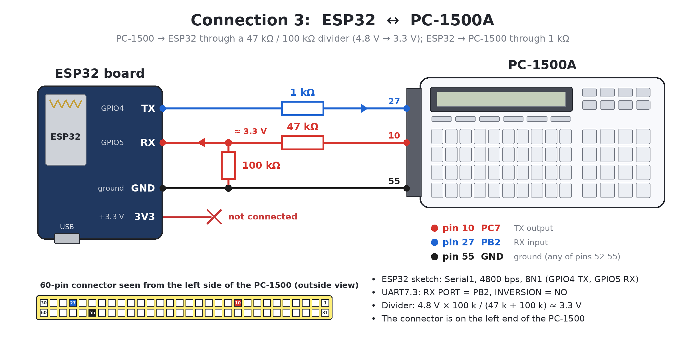

# UART7.3: Software UART for Sharp PC-1500(A)

**UART7.3: SERIN and SEROUT routines** by Alex F4VTS

UART7.3 creates a serial port (UART) in the Sharp PC-1500(A) pocket computer without a
dedicated interface (such as the CE-158) and without any hardware modification. An optional,
simple modification lets you use the UART while the PC-1500(A) is docked in the CE-150
printer/cassette interface.

| Document | Contents |
|---|---|
| [Instruction.pdf](Instruction.pdf) | full description and user manual |
| [Instruction_Francais.pdf](Instruction_Francais.pdf) | full description and user manual, in French |
| [Modification_for_use_with_CE-150_EN.pdf](Modification_for_use_with_CE-150_EN.pdf) | optional modification for use with the CE-150 |
| [Modification_for_use_with_CE-150_Francais.pdf](Modification_for_use_with_CE-150_Francais.pdf) | optional modification for use with the CE-150, in French |
| [HELP_NEW_memory.md](HELP_NEW_memory.md) | `NEW` values and routine/buffer addresses for every RAM configuration |
| [CALIBRATION_19200.md](CALIBRATION_19200.md) | SEROUT/SERIN v7.1 for 19200 bps and its calibration with an Arduino UNO |

## Features

- **UART7.3**, a BASIC program, puts the machine-language routines **SEROUT** (send) and
  **SERIN** (receive) into RAM. Together they take only about 200–250 bytes, plus two 255-byte
  buffers (TX and RX).
- The routines work by bit-banging: the signals are generated and read bit by bit in software,
  without a dedicated hardware circuit.
- Baud rate: **1200, 2400, 4800, 9600 or 19200 bps**, all in UART7.3 (`1`=1200, `2`=2400,
  `3`=4800, `4`, `0` or ENTER = 9600, `5`=19200). It contains two versions of the routines with
  the same `CALL`s, addresses and buffers: SEROUT/SERIN v6.2 for 1200–9600 bps and the fast
  SEROUT/SERIN v7.1 for 19200 bps, calibrated on a real PC-1500 with an Arduino UNO (see
  [CALIBRATION_19200.md](CALIBRATION_19200.md)).
- Format **8N1** (8 data bits, no parity, 1 stop bit), no RTS/CTS. An INVERSION option is
  available for devices with inverted signal levels.
- **TTL/CMOS signal levels (+3.3 V / +5 V). This is NOT RS-232:** connecting the PC-1500(A) to
  an RS-232 port (up to ±15 V) will destroy its electronics.
- Tested with USB-UART (FTDI) cables, Sharp, Casio and NEC pocket computers, sensors and modules,
  Arduino boards (5 V) and ESP32 boards (3.3 V).
- No port to open, select or close (unlike the CE-158): one `CALL` sends, one `CALL` receives.
  The UART works in packet mode, not in continuous mode.
- Runs on a bare **PC-1500A**. A **PC-1500** needs a RAM module (e.g. CE-155), because
  UART7.3 does not fit in its 2 KB.

## Repository contents

| File | Contents |
|---|---|
| `Basic/uart7.3.txt` | **UART7.3: puts SEROUT and SERIN into RAM, for 1200, 2400, 4800, 9600 or 19200 bps** |
| `Basic/pc1500_uart_test-v7.3.txt` | TEST7.3: TX/RX test for every speed (run it after UART7.3) |
| `Basic/pc1500_uart_link-v2.0.txt` | LINK2.0: link program for two PC-1500s: demo, send text, receive (1200–19200 bps, after UART7.3) |
| `Basic/pc1500_uart_quote-v1.0.txt` | QUOTE: "quote of the day" demo, asks an Arduino UNO (see [below](#demo-quote-of-the-day-with-an-arduino-uno)) |
| `Basic/pc1500_uart19200_calibration-v1.1.txt` | PC-1500 program for the 19200 bps calibration with an Arduino UNO (installs SEROUT/SERIN v7.1 itself) |
| `arduino/UART_Calibration/` | Arduino UNO sketch that measures the 19200 bps timing and prints a report |
| `arduino/UART_Quote_Gloom/` | Arduino UNO sketch for the quote demo: gloomy, grotesque little catastrophes from IT, electronics and space |
| `asm/` | LH5801 assembler sources and listings of SEROUT and SERIN v6.2 and v7.1 (19200 bps), with the comments that UART7.3 leaves out so that it fits into a bare PC-1500A |
| `wav/uart7.3.wav` | UART7.3 as a tape recording, for `CLOAD` |
| `wav/test7.3.wav` | TEST7.3 as a tape recording, for `CLOAD` |
| `wav/link2.wav` | LINK2.0 as a tape recording, for `CLOAD` |
| `wav/quote.wav` | QUOTE (the quote demo) as a tape recording, for `CLOAD` |
| `img/` | connector drawing, connection diagrams and photos |
| `Archive/` | older versions: v6.2 (1200–9600 bps) with the link program v1.0, v7.1 (19200 bps only), v7.2 with its tester |

## Connection

The UART uses the 60-pin connector on the left side of the PC-1500(A):

| Signal | Pin | Use |
|---|---|---|
| PC7 | 10 | TX: PC-1500 output |
| PB2 (CMT IN) | 27 | RX: PC-1500 input (default) |
| PB0 | 9 | RX: alternative input, needs the CE-150 modification |
| GND | 52–55 | ground, connect to the ground of the other device |


- Connect the PC-1500(A) output to the input of the other device and vice versa, through
  resistors of 1–10 kΩ. A 1.27 mm dual-row pin header (2 × 30 pins) fits the connector.
- The PC-1500 accepts about 2.4 V or more as a high level, so a 3.3 V device such as the
  ESP32 can drive it directly. In the PC-1500 → 3.3 V device direction use a resistor divider
  (47 kΩ in series, 100 kΩ to GND: about 3.3 V), because the ESP32 inputs tolerate at most
  about 3.6 V.
- PB2 is the cassette input of the CE-150, so without the modification the PC-1500(A) must be
  removed from the CE-150 while the UART is in use. With the modification, PB0 is used instead
  and the UART lines come out on a connector added to the CE-150.






## How to use

1. Switch off the PC-1500A, insert it into the CE-150 and connect the audio output of a
   computer or player to the EAR jack of the CE-150.
2. Switch on the PC-1500A, select PRO mode and type `NEW0` [ENTER], then `NEW&4400` [ENTER]
   (another value with a RAM module, see [HELP_NEW_memory.md](HELP_NEW_memory.md)), then
   `CLOAD` [ENTER].
3. Play `wav/uart7.3.wav` and wait until UART7.3 has loaded.
4. Without the modification, switch off the PC-1500A and remove it from the CE-150.
5. Connect the other UART device as shown above (or to the connector added to the CE-150 if
   the units are modified).
6. Select RUN mode and type `RUN` [ENTER]. UART7.3 shows `1=1200 2=2400 3=4800 BPS`, then asks
   `4/ENTER=9600 5=19200?`: `1`, `2`, `3`, `4` (or `0`, or ENTER = 9600) or `5`. At 19200 bps
   it also asks `TIMING (ENTER=STD,1=SET)`: ENTER uses the calibrated constants. Then it asks
   for the RX port (default PB2; press `0` for PB0 with the modification) and the inversion
   (default no). ENTER alone selects the default.
7. UART7.3 has no test (together with the code of both versions of the routines it would not
   fit into the memory of a PC-1500A). To test TX and RX, type `NEW` [ENTER] in PRO mode (the
   routines stay in memory), load TEST7.3 (`CLOAD` in the CE-150, `wav/test7.3.wav`) and `RUN` it.
8. When you no longer need UART7.3, type `NEW` [ENTER] in PRO mode. The routines stay in
   memory and the rest of the memory is free for your BASIC program.

To change the baud rate, port or inversion, run UART7.3 again.

## Commands

Addresses for a PC-1500A without a RAM module. UART7.3 shows the addresses for your
configuration; see also [HELP_NEW_memory.md](HELP_NEW_memory.md).

| Command | Action |
|---|---|
| `CALL&40C5,m` | **send** `m` bytes (1–255) from the TX buffer; `CALL&40C5` sends only the first byte |
| `CALL&4130,m` | **receive** at most `m` bytes into the RX buffer; the received length is returned in `m` |
| `CALL&4130` | **receive** a packet of any length, up to 255 bytes |

| Address | Contents |
|---|---|
| &4300 | TX buffer: put the data to send here with `POKE` |
| &4200 | RX buffer: read the received data with `PEEK` |
| &41FF | length of the last received packet |

SERIN waits up to about 30 s for the first character and returns to BASIC when no further
character arrives within about 0.5 s.

UART7.3 also writes a short description of the installation, so that other programs
(TEST7.3, LINK2.0) do not have to know the code of the two versions of the routines:

| Address | Contents |
|---|---|
| &41F7 | check byte: sum of 7 bytes of the installed code (SO+18, SI+77, SI+33…36, SI+48), modulo 256 |
| &41F8 | 83 (`"S"`): a description is present |
| &41F9 | speed: 1=1200, 2=2400, 3=4800, 4=9600, 5=19200 bps |
| &41FA | RX port: 0 = PB0, 2 = PB2 |
| &41FB | 0 = normal, 1 = inverted polarity |
| &41FC…&41FE | 19200 bps timing TB, RB, RQ |

A program reads it like this (the check byte tells whether the code is still the one
UART7.3 wrote, for example not replaced by an older version):

```
100 B = PEEK (A0 + &1F9) : P = PEEK (A0 + &1FA) : V = PEEK (A0 + &1FB)
105 C = PEEK (SO + 18) + PEEK (SI + 77) + PEEK (SI + 33) + PEEK (SI + 34)
110 C = C + PEEK (SI + 35) + PEEK (SI + 36) + PEEK (SI + 48)
115 C = C - 256 * INT (C / 256)
120 IF PEEK (A0 + &1F8) <> 83 OR C <> PEEK (A0 + &1F7) GOTO 960
125 BD = VAL (MID$ ("1200 2400 4800 9600 19200", 5 * B - 4, 5))
```

LINK2.0 works at all five speeds (both PC-1500 with UART7.3, the same speed and
polarity). At 19200 bps its preamble before each message is 170 NUL bytes (about
90 ms) instead of 150 ms, so that a message of 80 characters still fits into the TX buffer.

## Demo: quote of the day with an Arduino UNO

The PC-1500 asks, in a loop and at random, `What's for today?`, `tomorrow?` or `yesterday?`
(its display shows `WHAT IS GOING ON TODAY?`, `WHAT IS UP TOMORROW?` or
`WHAT HAPPENED YESTERDAY?`), and the Arduino answers with a short, gloomy and grotesque
sentence from IT, electronics and space, at most 26 characters, one line of the display:
`A consultant ate the LPTs.`, `The UART sang in water.`, `Diodes danced gloomily.`,
`Mournfully the HDD worked.` The PC-1500 shows each answer for about 2 seconds (`WAIT 120` in
line 290), then asks again.

| PC-1500 (60-pin) | In between | Arduino UNO |
|---|---|---|
| PC7 (TX), pin 10 | Schottky diode, cathode (stripe) toward PC7, or 1 kΩ | A5 |
| PB2 (RX), pin 27 | 470 Ω | A4 |
| GND, pins 52–55 | – | GND |

(The same wiring as for the 19200 bps calibration; a 4.7 kΩ resistor from A5 to 5 V is
recommended with the diode. The LCD Keypad Shield is optional.)

1. Upload `arduino/UART_Quote_Gloom/UART_Quote_Gloom.ino` (19200 bps; another speed: change
   `BAUD`).
2. On the PC-1500 run UART7.3: speed `5`, RX port PB2, inversion no. Then `NEW` in PRO mode
   and load QUOTE (`CLOAD` in the CE-150, `wav/quote.wav`) or type in
   `Basic/pc1500_uart_quote-v1.0.txt`.
3. `RUN`. The program runs until you press BREAK (ON). Without an answer it waits about
   30 s, shows `NO ANSWER (ARDUINO?)` and asks again.

The sentences follow four patterns: subject, verb and object; subject, verb and place;
subject, verb and adverb; adverb, subject and verb, in the present (today), future (tomorrow)
or past tense (yesterday). The word lists (404 subjects, also plural: `Diodes dance`, 328 verbs,
133 adverbs, 148 places and 503 objects; the sketch takes about 87 % of the UNO's flash) are in
the sketch and can be changed freely: a sentence longer than one line is never sent. The serial
monitor (115200 bps) shows every question and answer.

## Author

Comments, bug reports, ideas and inquiries: alex.f4vts@gmail.com (I may not be able to respond
immediately).

I created UART7.3, the SERIN/SEROUT software UART, myself, with help from Claude Code. It is
based on the idea of the SAVER/LOADER program published in the Japanese magazine I/O (1983).
