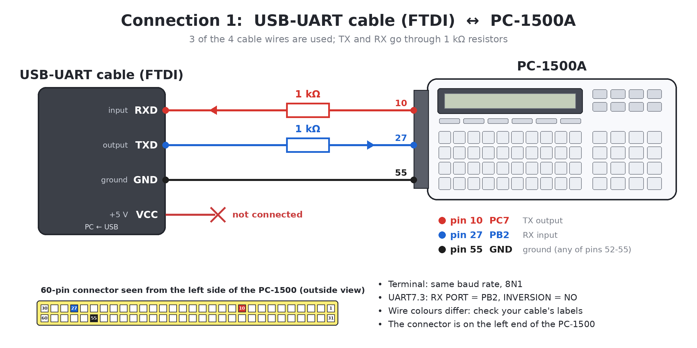
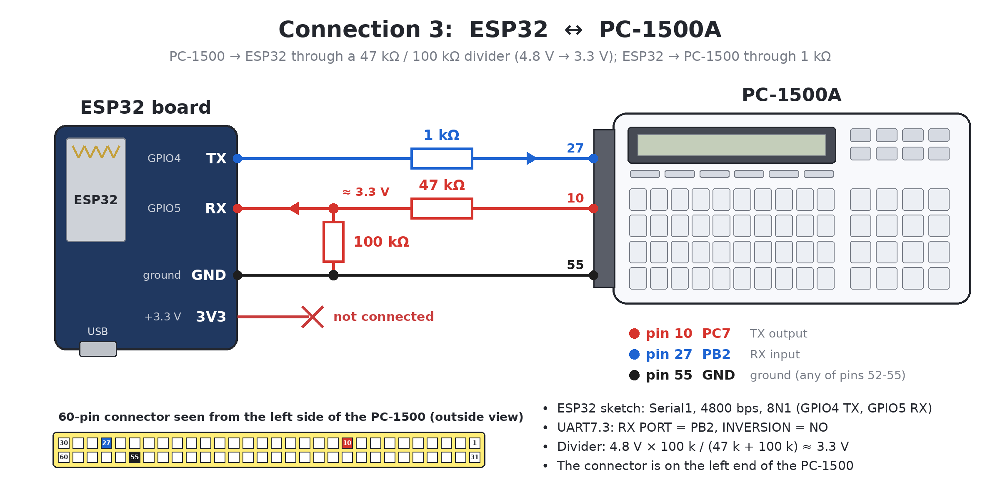

# UART7.3: 用于夏普 PC-1500(A) 的软件 UART

**UART7.3：SERIN 与 SEROUT 例程** 作者：Alex F4VTS

UART7.3 可以在没有专用接口（如 CE-158）、且无需任何硬件修改的情况下，在夏普 PC-1500(A) 掌上电脑中创建一个串行端口（UART）。一个可选的简单改装，可以让你在 PC-1500(A) 连接在 CE-150 打印机/磁带接口底座上时，也能使用该 UART。

| 文档 | 内容 |
|---|---|
| [Instruction.pdf](Instruction.pdf) | 完整说明和用户手册 |
| [Instruction_Francais.pdf](Instruction_Francais.pdf) | 完整说明和用户手册（法文版） |
| [Modification_for_use_with_CE-150_EN.pdf](Modification_for_use_with_CE-150_EN.pdf) | 配合 CE-150 使用的可选改装（英文版） |
| [Modification_for_use_with_CE-150_Francais.pdf](Modification_for_use_with_CE-150_Francais.pdf) | 配合 CE-150 使用的可选改装（法文版） |
| [Modification_for_use_with_CE-150_CN.pdf](Modification_for_use_with_CE-150_CN.pdf) | 配合 CE-150 使用的可选改装（中文版） |
| [HELP_NEW_memory.md](HELP_NEW_memory.md) | 针对每种 RAM 配置的 `NEW` 值和例程/缓冲区地址 |
| [CALIBRATION_19200.md](CALIBRATION_19200.md) | 用于 19200 bps 的 SEROUT/SERIN v7.1 例程，及其使用 Arduino UNO 进行的校准 |

## 特性

- **UART7.3** 是一个 BASIC 程序，它将机器语言例程 **SEROUT**（发送）和 **SERIN**（接收）写入 RAM。它们总共只占用约 200–250 字节，外加两个 255 字节的缓冲区（TX 和 RX）。
- 这些例程通过位翻转（bit-banging）工作：信号完全由软件逐位生成和读取，没有专用的硬件电路。
- 波特率：**1200、2400、4800、9600 或 19200 bps**，全都在 UART7.3 中（`1`=1200，`2`=2400，`3`=4800，`4`、`0` 或 ENTER = 9600，`5`=19200）。它包含两个版本的例程，具有相同的 `CALL` 指令、地址和缓冲区：SEROUT/SERIN v6.2 用于 1200–9600 bps，以及快速的 SEROUT/SERIN v7.1 用于 19200 bps，后者在真实的 PC-1500 上使用 Arduino UNO 进行了校准（参见 [CALIBRATION_19200.md](CALIBRATION_19200.md)）。
- 格式为 **8N1**（8 个数据位，无校验，1 个停止位），无 RTS/CTS 流控。提供了一个 INVERSION（反相）选项，用于具有反相信号电平的设备。
- **TTL/CMOS 信号电平（+3.3 V / +5 V）。这不是 RS-232：** 将 PC-1500(A) 连接到 RS-232 端口（电压高达 ±15 V）会烧毁其电子元件。
- 已使用 USB-UART (FTDI) 线缆、夏普/Casio/NEC 掌上电脑、传感器和模块、Arduino 板（5 V）和 ESP32 板（3.3 V）进行过测试。
- 没有需要打开、选择或关闭的端口（不同于 CE-158）：一个 `CALL` 发送，一个 `CALL` 接收。UART 以数据包模式工作，而不是连续模式。
- 可在裸机 **PC-1500A** 上运行。**PC-1500** 需要 RAM 模块（例如 CE-155），因为 UART7.3 无法塞进其 2 KB 的内存中。

## 仓库内容

| 文件 | 内容 |
|---|---|
| `Basic/uart7.3.txt` | **UART7.3：将 SEROUT 和 SERIN 写入 RAM，支持 1200、2400、4800、9600 或 19200 bps** |
| `Basic/pc1500_uart_test-v7.3.txt` | TEST7.3：针对每种速度的 TX/RX 测试（在 UART7.3 之后运行） |
| `Basic/pc1500_uart_link-v2.0.txt` | LINK2.0：两台 PC-1500 之间的链接程序：演示、发送文本、接收（1200–19200 bps，在 UART7.3 之后） |
| `Basic/pc1500_uart_quote-v1.0.txt` | QUOTE：“每日金句”演示，向 Arduino UNO 请求数据（见[下文](#demo-quote-of-the-day-with-an-arduino-uno)） |
| `Basic/pc1500_uart19200_calibration-v1.1.txt` | 用于 Arduino UNO 19200 bps 校准的 PC-1500 程序（自行安装 SEROUT/SERIN v7.1） |
| `arduino/UART_Calibration/` | 测量 19200 bps 时序并打印报告的 Arduino UNO 草图 |
| `arduino/UART_Quote_Gloom/` | 用于金句演示的 Arduino UNO 草图：来自 IT、电子和太空领域的阴郁、怪诞的小灾难 |
| `asm/` | SEROUT 和 SERIN v6.2 及 v7.1（19200 bps）的 LH5801 汇编器源代码和清单，包含 UART7.3 为了塞进裸机 PC-1500A 而省略的注释 |
| `wav/uart7.3.wav` | 作为磁带录音的 UART7.3，用于 `CLOAD` |
| `wav/test7.3.wav` | 作为磁带录音的 TEST7.3，用于 `CLOAD` |
| `wav/link2.wav` | 作为磁带录音的 LINK2.0，用于 `CLOAD` |
| `wav/quote.wav` | 作为磁带录音的 QUOTE（金句演示），用于 `CLOAD` |
| `img/` | 连接器图纸、连接图和照片 |
| `Archive/` | 旧版本：v6.2（1200–9600 bps）及链接程序 v1.0、v7.1（仅 19200 bps）、v7.2 及其测试器 |

## 连接方式

UART 使用 PC-1500(A) 左侧的 60 针连接器：

| 信号 | 引脚 | 用途 |
|---|---|---|
| PC7 | 10 | TX：PC-1500 输出 |
| PB2 (CMT IN) | 27 | RX：PC-1500 输入（默认） |
| PB0 | 9 | RX：备用输入，需要配合 CE-150 改装 |
| GND | 52–55 | 地线，连接到其他设备的地线 |


- 将 PC-1500(A) 的输出连接到另一设备的输入，反之亦然，**中间需串联 1–10 kΩ 的电阻**。一个 1.27 mm 双排针座（2 × 30 引脚）适合该连接器。
- PC-1500 接受约 2.4 V 或更高电压作为高电平，因此像 ESP32 这样的 3.3 V 设备可以直接驱动它。在 PC-1500 → 3.3 V 设备的方向上，请使用分压器（串联 47 kΩ，接 100 kΩ 到地：约 3.3 V），因为 ESP32 的输入最大只能承受约 3.6 V。
- PB2 是 CE-150 的磁带输入，因此**如果不进行改装，在使用 UART 时必须将 PC-1500(A) 从 CE-150 上拔下**。通过改装，改用 PB0，并且 UART 线路会从添加到 CE-150 上的连接器引出。






## 如何使用

1. 关闭 PC-1500A，将其插入 CE-150，并将电脑或播放器的音频输出连接到 CE-150 的 EAR 插孔。
2. 开启 PC-1500A，选择 PRO 模式，输入 `NEW0` [ENTER]，然后输入 `NEW&4400` [ENTER]（如果使用 RAM 模块，请换用其他值，参见 [HELP_NEW_memory.md](HELP_NEW_memory.md)），然后输入 `CLOAD` [ENTER]。
3. 播放 `wav/uart7.3.wav` 并等待 UART7.3 载入完成。
4. **如果不进行硬件改装**，请关闭 PC-1500A 并将其从 CE-150 上拔下。
5. 如上所述连接其他 UART 设备（如果已进行改装，则连接到 CE-150 上添加的连接器）。
6. 选择 RUN 模式并输入 `RUN` [ENTER]。UART7.3 会显示 `1=1200 2=2400 3=4800 BPS`，然后询问 `4/ENTER=9600 5=19200?`：输入 `1`、`2`、`3`、`4`（或 `0`，或直接 ENTER = 9600）或 `5`。在 19200 bps 时，它还会询问 `TIMING (ENTER=STD,1=SET)`：按 ENTER 使用校准后的常量。然后它会询问 RX 端口（默认 PB2；如果进行了改装，请按 `0` 选择 PB0）和反转选项（默认否）。只按 ENTER 即选择默认值。
7. UART7.3 本身没有测试功能（连同两个版本的例程代码，它无法塞进 PC-1500A 的内存中）。要测试 TX 和 RX，请在 PRO 模式下输入 `NEW` [ENTER]（例程会留在内存中），然后载入 TEST7.3（在 CE-150 中 `CLOAD`，播放 `wav/test7.3.wav`）并 `RUN` 它。
8. 当你不再需要 UART7.3 时，在 PRO 模式下输入 `NEW` [ENTER]。例程会保留在内存中，其余内存可供你的 BASIC 程序使用。

要更改波特率、端口或反转设置，请再次运行 UART7.3。

## 命令

以下地址适用于没有 RAM 模块的 PC-1500A。UART7.3 会显示你当前配置的地址；另请参阅 [HELP_NEW_memory.md](HELP_NEW_memory.md)。

| 命令 | 操作 |
|---|---|
| `CALL&40C5,m` | **发送** TX 缓冲区中的 `m` 个字节（1–255）；`CALL&40C5` 仅发送第一个字节 |
| `CALL&4130,m` | **接收**最多 `m` 个字节到 RX 缓冲区；接收到的长度会返回到 `m` 中 |
| `CALL&4130` | **接收**任意长度的数据包，最大 255 字节 |

| 地址 | 内容 |
|---|---|
| &4300 | TX 缓冲区：使用 `POKE` 将待发送的数据放到这里 |
| &4200 | RX 缓冲区：使用 `PEEK` 读取接收到的数据 |
| &41FF | 最后一次接收的数据包长度 |

SERIN 等待第一个字符最多约 30 秒，如果在约 0.5 秒内没有更多字符到达，则返回 BASIC。

SEROUT 和 SERIN 在开始时关闭中断（`RIE`），因为中断会干扰位时序；并在返回 BASIC（运行于开启中断状态）之前再次打开中断（`SIE`）。（直到 2026 年 10 月，这些例程在返回时仍关闭中断；这在实践中没有造成危害，因为下一个带有 `SIE` 的 ROM 例程（例如下一次显示输出）会再次将其打开。）

UART7.3 还会写入一段简短的安装描述，以便其他程序（TEST7.3、LINK2.0）无需了解两个版本例程的代码：

| 地址 | 内容 |
|---|---|
| &41F7 | 校验字节：已安装代码的 7 个字节之和（SO+18, SI+77, SI+33…36, SI+48），模 256 |
| &41F8 | 83 (`"S"`)：表示存在描述信息 |
| &41F9 | 速度：1=1200, 2=2400, 3=4800, 4=9600, 5=19200 bps |
| &41FA | RX 端口：0 = PB0, 2 = PB2 |
| &41FB | 0 = 正常，1 = 反转极性 |
| &41FC…&41FE | 19200 bps 时序 TB, RB, RQ |

程序读取它的方式如下（校验字节用于判断代码是否仍是 UART7.3 写入的版本，例如没有被旧版本替换）：

```basic
100 B = PEEK (A0 + &1F9) : P = PEEK (A0 + &1FA) : V = PEEK (A0 + &1FB)
105 C = PEEK (SO + 18) + PEEK (SI + 77) + PEEK (SI + 33) + PEEK (SI + 34)
110 C = C + PEEK (SI + 35) + PEEK (SI + 36) + PEEK (SI + 48)
115 C = C - 256 * INT (C / 256)
120 IF PEEK (A0 + &1F8) <> 83 OR C <> PEEK (A0 + &1F7) GOTO 960
125 BD = VAL (MID$ ("1200 2400 4800 9600 19200", 5 * B - 4, 5))
  LINK2.0 在所有五种速度下均可工作（两台运行 UART7.3 的 PC-1500，需相同的速度和极性）。在 19200 bps 下，每条消息前导码为 170 个 NUL 字节（约 90 毫秒），而不是 150 毫秒，以便 80 个字符的消息仍能放入 TX 缓冲区。

## 演示：使用 Arduino UNO 的每日金句

PC-1500 会随机循环询问 `What's for today?`（今天怎么了？）、`tomorrow?`（明天呢？）或 `yesterday?`（昨天呢？）（其屏幕显示 `WHAT IS GOING ON TODAY?`、`WHAT IS UP TOMORROW?` 或 `WHAT HAPPENED YESTERDAY?`），Arduino 则用一句来自 IT、电子和太空领域的简短、阴郁且怪诞的句子作答，最多 26 个字符，占屏幕一行：`A consultant ate the LPTs.`（一个顾问吃掉了 LPT 端口。）、`The UART sang in water.`（UART 在水中歌唱。）、`Diodes danced gloomily.`（二极管阴郁地跳舞。）、`Mournfully the HDD worked.`（硬盘悲伤地工作着。）PC-1500 会将每个答案显示约 2 秒（第 290 行的 `WAIT 120`），然后再次询问。

| PC-1500（60 针） | 中间连接件 | Arduino UNO |
|---|---|---|
| PC7 (TX), 引脚 10 | 肖特基二极管，阴极（条纹侧）朝向 PC7，或 1 kΩ 电阻 | A5 |
| PB2 (RX), 引脚 27 | 470 Ω | A4 |
| GND, 引脚 52–55 | – | GND |

（与 19200 bps 校准的接线相同；使用二极管时，建议从 A5 到 5 V 接一个 4.7 kΩ 电阻。LCD Keypad Shield 为可选配件。）

1. 上传 `arduino/UART_Quote_Gloom/UART_Quote_Gloom.ino`（19200 bps；其他速度：更改 `BAUD`）。
2. 在 PC-1500 上运行 UART7.3：速度选 `5`，RX 端口选 PB2，反转选否。然后在 PRO 模式下输入 `NEW`，载入 QUOTE（在 CE-150 中 `CLOAD`，播放 `wav/quote.wav`）或手动输入 `Basic/pc1500_uart_quote-v1.0.txt`。
3. `RUN`。程序会一直运行，直到你按 BREAK（ON）键。如果没有收到答案，它会等待约 30 秒，显示 `NO ANSWER (ARDUINO?)`（无应答（Arduino？）），然后再次询问。

这些句子遵循四种模式：主语、动词和宾语；主语、动词和地点；主语、动词和副词；副词、主语和动词，使用现在时（今天）、将来时（明天）或过去时（昨天）。单词列表（404 个主语，也有复数形式：`Diodes dance`，328 个动词，133 个副词，148 个地点和 503 个宾语；该草图约占 UNO Flash 存储的 87%）位于草图中，可以自由更改：超过一行的句子永远不会被发送。串口监视器（115200 bps）会显示每个问题和答案。

## 作者

评论、错误报告、想法和咨询：alex.f4vts@gmail.com（我可能无法立即回复）。

UART7.3，即 SERIN/SEROUT 软件 UART，是我在 Claude Code 的帮助下自行创建的。它的灵感来源于 1983 年日本杂志《I/O》上发表的 SAVER/LOADER 程序的想法。
